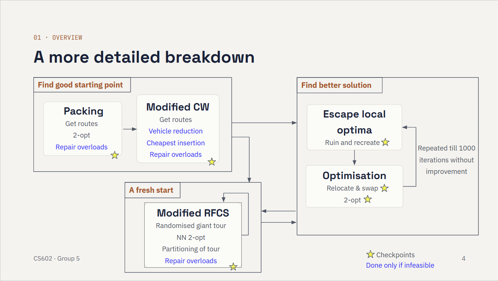

# CS602 Algorithm Design and Implementation (G2 - Group 5)

### [Final presentation slides](https://docs.google.com/presentation/d/1wnqwfYSPhZJwy0msSXpv69tcGVAU7V-l1JVBjTRq1Kw/edit)


## Setup

```bash
conda env create -f environment.yml
conda activate algo-design
```


## Running the algorithm

The algorithm is in `final_solution.py`. Call `run_algo`:

```python
run_algo(cust_demands, dist_matrix, vehicle_cap, num_vehicles, instance_type)
```

- `cust_demands`: list of demands, depot first (`[0, 2, 2, 3]`)
- `dist_matrix`: list of rows of the distance matrix
- `vehicle_cap`: capacity of each vehicle
- `num_vehicles`: number of vehicles available
- `instance_type`: `"SMALL"`, `"MEDIUM"` or `"LARGE"`. The run stops at 95% of the limit for the instance type.

It returns `(best_cost, best_routes)`, where `best_routes` is a list of routes.


## Input and output format

### Input:

Each instance is a plain text file with 4 parts, in this order:

1. Instance type: small/medium/large
2. Customer demands: on one line, separated by spaces. The first value is the depot (vertex `0`) and is always `0`.
3. Distance matrix: one row per line, values separated by spaces. It is symmetric, and row/column `0` is the depot.
4. Vehicle capacity
5. number of vehicles

Example:

```
SMALL 
0 2 2 3
0 2.5 5.6 6.0
2.5 0 3.9 6.5
5.6 3.9 0 5.2
6.0 6.5 5.2 0
5
2
```


### Output: 

The total cost on the first line, then one route per line, each starting and ending at the depot (`0`):

```
21.8
0 1 0
0 2 3 0
```


## Our approach




## Benchmarking

`run_benchmarks.py` runs `final_solution.py` on the instances in `test_cases/benchmarks` (sets A, B, P and X), checks that each solution is feasible, and compares its cost with the optimal cost in the matching `*_opt.txt` file.

```bash
python run_benchmarks.py                                  # every instance (about 3 min each)
python run_benchmarks.py --sets A B                       # only sets A and B
python run_benchmarks.py --sets X --limit 5               # the 5 smallest instances of set X
python run_benchmarks.py --instances A-n32-k5 X-n101-k25  # chosen instances
python run_benchmarks.py --limits 10 20 30                # quick check with shorter limits
```

Results are saved in `logs/`, and used to select the final test cases for submission. 


## Team members
- Andrew Ho
- Amelia Lee
- Li Song Xi
- Oh Rui Han
- Peng You Yun
